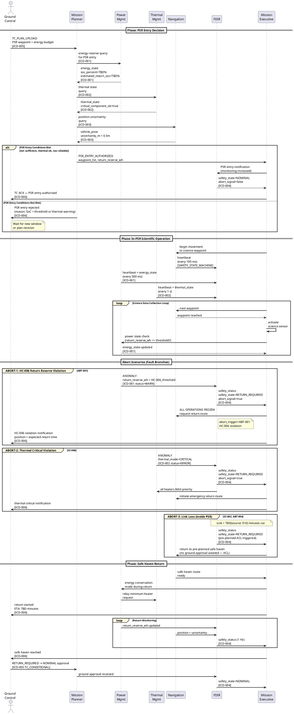
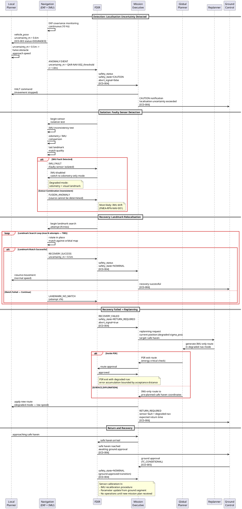
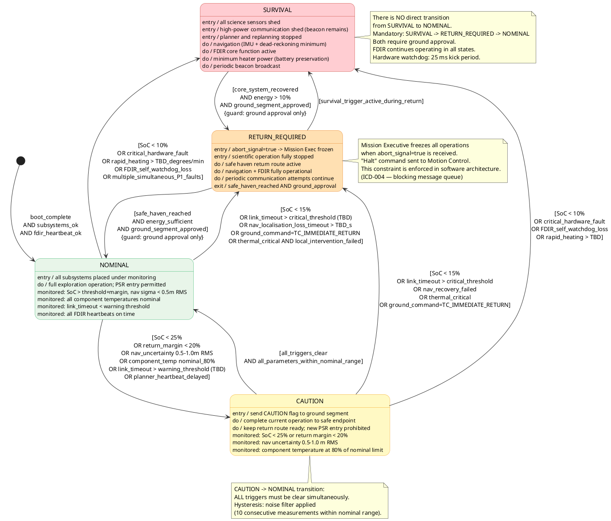

# status: draft
# owner: Agent C
# depends_on: [docs/architecture/ICD_TEMPLATES.md, docs/architecture/SAFETY_STATE_MACHINE.md, docs/adr/FMEA_KRITIK_MODULLER.md, autonomy/autonomy_matrix.md]
# open_items: [ICD references consistent with ICD_TEMPLATES.md v1.0; TBD parameters marked as notes in diagrams]

# LUNA-AI PlantUML Diagrams — v1.0

**Document ID:** LUNA-AI-ARCH-004  
**Version:** 0.1-draft  
**Date:** 2026-11-14  
**Related Documents:** LUNA-AI-ARCH-001 (Safety State Machine), LUNA-AI-ARCH-002 (ICD Templates), LUNA-AI-FMEA-001

---

## Diagram 1 — Component Diagram

All modules, interfaces and segment groups. Ground segment / flight segment / simulation packages separated. ICD reference on each interface.

```plantuml
@startuml LUNA-AI Component Diagram

' =====================================================
' LUNA-AI Component Diagram v1.0
' Document: LUNA-AI-ARCH-004
' Related: ICD-001..ICD-006 (LUNA-AI-ARCH-002)
' =====================================================

skinparam componentStyle rectangle
skinparam packageStyle frame
skinparam backgroundColor #FAFAFA
skinparam component {
  BackgroundColor #E8F4FD
  BorderColor #2980B9
}

' =====================================================
' GROUND SEGMENT
' =====================================================
package "Ground Segment" #EAF7EA {

  package "Scientific Analysis & Mission Design" #D5F0D5 {
    [Mission Intelligence\n(Target Scoring &\nConstraint Check)] as MI
    [Ground Control UI\n(apps/ground-control)] as GC
    [Data Platform\n(Telemetry Processing &\nArchive)] as DP
  }

  package "Mission Planning Infrastructure" #D5F0D5 {
    [Mission Planner\n(Route & Resource Planning)] as GMP
    [Orbital Geometry\n(Sun/Earth Window)] as OG
  }
}

' =====================================================
' FLIGHT SEGMENT (Vehicle)
' =====================================================
package "Flight Segment (Vehicle)" #FFF3E0 {

  package "Autonomy & Execution" #FFE0B2 {
    [Mission Executive] as ME
    [Global Planner\n(Route Planning)] as GP
    [Local Planner\n(Obstacle Avoidance)] as LP
    [Replanner\n(Replanning)] as RP
  }

  package "Perception & Navigation" #FFE0B2 {
    [Localization\n(EKF + IMU + Landmark)] as LOC
    [Terrain Analyzer\n(LiDAR + Camera)] as TA
  }

  package "Resource Management" #FFE0B2 {
    [Power Management\n(SoC, Budget)] as PM
    [Thermal Management\n(Heater Control)] as TM
  }

  package "Safety" #FFE0B2 {
    [FDIR\n(Fault Detection & Recovery)] as FDIR
    [Safety State Machine\n(NOMINAL/CAUTION/\nRETURN_REQUIRED/SURVIVAL)] as SSM
  }

  package "Hardware Interfaces" #FFE0B2 {
    [Motion Control\n(Motor Drivers)] as MC
    [Communication\n(RF Transceiver)] as COM
    [OBC\n(Main Computer)] as OBC
  }
}

' =====================================================
' SIMULATION & VALIDATION SEGMENT
' =====================================================
package "Simulation & Validation Segment" #F3E5F5 {
  [Digital Twin\n(Vehicle Simulation)] as DT
  [Environment Model\n(Lunar Surface Environment)] as EM
  [Scenario Runner\n(YAML Scenario Engine)] as SR
  [Fault Injector\n(Fault Injection)] as FI
  [SIL/HIL Bridge] as HIL
}

' =====================================================
' INTERFACES (with ICD references)
' =====================================================

' ICD-001: Power Mgmt → Mission Planner (flight) / Ground Planner (downlink reflection)
PM -right-> ME : ICD-001\nenergy_state\n(1 Hz / 10 Hz CAUTION)
PM -right-> GMP : ICD-001\nenergy_state\n(telemetry reflection)

' ICD-002: Thermal Mgmt → Mission Executive
TM -right-> ME : ICD-002\nthermal_state\n(1 Hz / 10 Hz CAUTION)

' ICD-003: Navigation → Local Planner
LOC -right-> LP : ICD-003\nvehicle_pose\n(>=10 Hz moving)
LOC -right-> GP : ICD-003\nvehicle_pose\n(1 Hz nominal)

' ICD-004: FDIR → Mission Executive
FDIR -right-> ME : ICD-004\nsafety_status\n(event-driven + 1 Hz)
SSM --> FDIR : state transition\ndecision

' ICD-005: Ground → Flight (Uplink — CCSDS TC)
GMP -down-> COM : ICD-005\nTC Uplink\n(CCSDS)
GC -down-> COM : ICD-005\nTC_IMMEDIATE\n(P1 Command)

' ICD-006: Flight → Ground (Downlink — CCSDS TM)
COM -up-> DP : ICD-006\nTM Downlink\n(CCSDS)
COM -up-> GC : ICD-006\nTelemetry\n(1 Hz / 10 Hz)

' Vehicle internal connections
ME --> GP : apply mission\nstep
GP --> LP : waypoint\nlist
LP --> MC : motion\ncommand
TA --> LOC : point cloud\n+ image
MC --> LOC : encoder\nfeedback
FDIR --> PM : power shed\ncommand (SURVIVAL)
FDIR --> TM : heater priority\ncommand (CAUTION+)
FDIR --> MC : halt command\n(RETURN_REQUIRED)
FDIR --> COM : emergency beacon\n(SURVIVAL)
RP --> GP : new route\nplan

' Simulation connections
DT --> LOC : simulated\ntelemetry
EM --> DT : environment\nconditions
SR --> FI : scenario\nevents
FI --> DT : fault injection\n(sensor/motor/power)
HIL --> OBC : HIL\ninterface

' Ground internal connections
MI --> GMP : target ranking\n+ constraint list
OG --> GMP : window\nconstraints
DP --> MI : processed\ntelemetry

@enduml
```

---

## Diagram 2 — PSR Operation Sequence Diagram

From PSR (Permanently Shadowed Region) entry decision to end of scientific mission and safe haven return. Including critical message exchanges, fault branches, abort triggers.

---

## Diagram 3 — Fault Management Sequence Diagram

Scenario: Localisation uncertainty exceeded → FDIR decision → replanning → return or recovery. Related: SC-004 (operational_scenarios.md).

---

## Diagram 4 — Deployment Diagram

Hardware on vehicle and software components running on them. Ground segment servers and connection type.

```plantuml
@startuml LUNA-AI Deployment Diagram

' =====================================================
' Deployment Diagram v1.0
' Vehicle hardware + ground segment servers + connections
' =====================================================

skinparam nodeStyle rectangle
skinparam componentStyle rectangle
skinparam backgroundColor #FAFAFA

' =====================================================
' VEHICLE (Flight Hardware)
' =====================================================
node "Rover (Vehicle)" as ROVER #FFE0B2 {

  node "Main Computer (OBC)\n[FreeRTOS, COTS Rad-Hard CPU\nTBD-SNS-001]" as OBC #FFCC80 {
    component [FDIR Task\n(Priority: Highest)] as FDIR_SW
    component [Mission Executive] as ME_SW
    component [Global Planner] as GP_SW
    component [Local Planner] as LP_SW
    component [Replanner] as RP_SW
    component [Power Mgmt Task] as PM_SW
    component [Thermal Mgmt Task] as TM_SW
    component [Communication Task] as COM_SW
  }

  node "Navigation Processor\n[TBD — separate SoC or separate\ncore on OBC]" as NAV_CPU #FFCC80 {
    component [EKF Localization] as EKF_SW
    component [Terrain Analyzer] as TA_SW
    component [Sensor Fusion] as SF_SW
  }

  node "IMU Module\n[TBD-SNS-001/002]" as IMU_HW #FFD54F {
    component [Accelerometer + Gyroscope] as IMU_SENS
  }

  node "LiDAR\n[TBD-SNS-001]" as LIDAR_HW #FFD54F {
    component [Point Cloud\nGenerator] as LIDAR_SW
  }

  node "Camera System\n[TBD-SNS-001]" as CAM_HW #FFD54F {
    component [Stereo Image\nProcessing] as CAM_SW
  }

  node "RF Module\n[TBD-COM-001]" as RF_HW #FFD54F {
    component [High Gain Antenna\n(HGA)] as HGA
    component [UHF Omni Antenna\n(Backup)] as UHF
  }

  node "Power System\n[TBD-BAT-001/002, TBD-SOL-001]" as PWR_HW #FFD54F {
    component [Solar Panel\n+ Charge Regulator] as SOLAR
    component [Battery Module\n(Dual — TBD-RED-003)] as BAT
    component [PDU\n(Dual Channel)] as PDU
  }

  node "Thermal System\n[TBD-THM-001]" as THM_HW #FFD54F {
    component [Heaters\n(Primary + Fallback)] as HEATER
    component [Temperature Sensors\n(>=2 independent/point)] as TEMP_SENS
  }

  node "Motion System" as MOT_HW #FFD54F {
    component [Motor Drivers\n(4+ wheel)] as MOTOR_DRV
    component [Wheel Encoders] as ENC
  }

  node "Hardware Watchdog\n[Independent HW Timer]" as HW_WD #EF9A9A {
    component [FDIR HW Watchdog\n(25 ms kick)] as WD_HW
  }
}

' =====================================================
' GROUND SEGMENT
' =====================================================
node "Ground Control Centre\n(Ground Segment Server)" as GROUND #E8F5E9 {

  node "Mission Control Server" as MCS #C8E6C9 {
    component [Ground Control UI\n(apps/ground-control)] as GC_UI
    component [Mission Planner\n(Route & Resource)] as GMP_SW
    component [Mission Intelligence\n(Target & Constraint)] as MI_SW
  }

  node "Data Processing Server" as DPS #C8E6C9 {
    component [Data Platform\n(Ingestion + Catalog)] as DP_SW
    component [Telemetry Archive] as TM_ARCH
    component [Scientific Data Store] as SCI_DATA
  }

  node "Simulation Server" as SIM_SRV #C8E6C9 {
    component [Digital Twin] as DT_SW
    component [Environment Model] as EM_SW
    component [Scenario Runner] as SR_SW
    component [Fault Injector] as FI_SW
  }

  node "Deep Space Network\n(DSN Antenna)" as DSN #A5D6A7 {
    component [RF Uplink/Downlink\n(CCSDS)] as DSN_RF
  }
}

' =====================================================
' CONNECTIONS
' =====================================================

' Vehicle hardware connections
OBC --> RF_HW : UART/SPI\ncommunication command
OBC --> PWR_HW : I2C/CAN\npower control
OBC --> THM_HW : GPIO / I2C\nheater control
OBC --> MOT_HW : CAN Bus\nmotor command
OBC --> HW_WD : FDIR HW kick\n(25 ms)
NAV_CPU --> IMU_HW : SPI\nsampling (200+ Hz)
NAV_CPU --> LIDAR_HW : Ethernet/PCIe\npoint cloud
NAV_CPU --> CAM_HW : USB3/Ethernet\nimage stream
OBC --> NAV_CPU : IPC / Shared Memory\nvehicle_pose [ICD-003]

' Ground-vehicle connection
DSN_RF --> RF_HW : CCSDS TC/TM\n(ICD-005 Uplink / ICD-006 Downlink)\n[TBD-COM-001: frequency, band]

' Ground internal connections
GC_UI --> MCS : HTTP/gRPC
GMP_SW --> MI_SW : target list
DP_SW --> TM_ARCH : telemetry store
DSN_RF --> DP_SW : raw TM\nreception
SIM_SRV --> DPS : simulation\ntelemetry
SIM_SRV --> MCS : SIL test\ninterface

@enduml
```

---

## Diagram 5 — Safety State Machine

Nominal / Caution / Return_Required / Survival. Transition conditions and guard expressions. Consistent with LUNA-AI-ARCH-001.

---

## Diagram Reference Table

| # | Diagram | PlantUML Type | Source Documents | Purpose |
|---|----------|--------------|-----------------|------|
| 1 | Component Diagram | Component | ICD-001..006, ADR-005 | All modules and interfaces; segment groups |
| 2 | PSR Operation Sequence | Sequence | SC-003, ICD-001..005, HC-006 | PSR entry decision → mission → return; abort branches |
| 3 | Fault Management Sequence | Sequence | SC-004, FMEA-RPN-NAV-001, QAR-NAV-002 | Localisation loss → FDIR → replanning → return |
| 4 | Deployment Diagram | Deployment | ADR-003, ICD-005/006, TBD-SNS/BAT/COM | Hardware nodes, software deployment, connection types |
| 5 | Safety State Machine | State | LUNA-AI-ARCH-001, ADR-005, QAR FDIR-001..005 | 4 safety states, transition guards, FDIR independence |

---

## Revision History

| Version | Date | Change |
|----------|-------|------------|
| 0.1 | 2026-11-14 | First draft — Agent C, C2 task; 5 diagrams |
