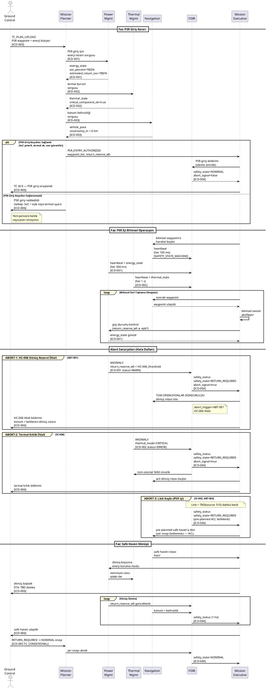
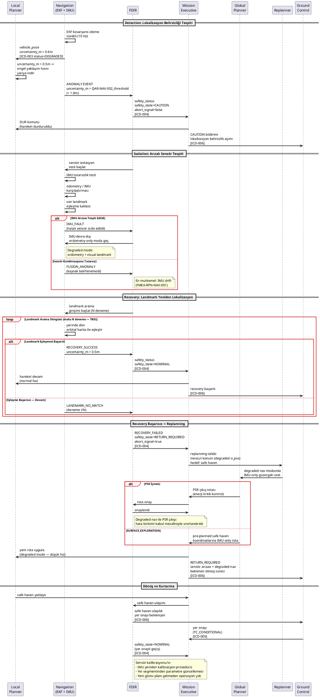
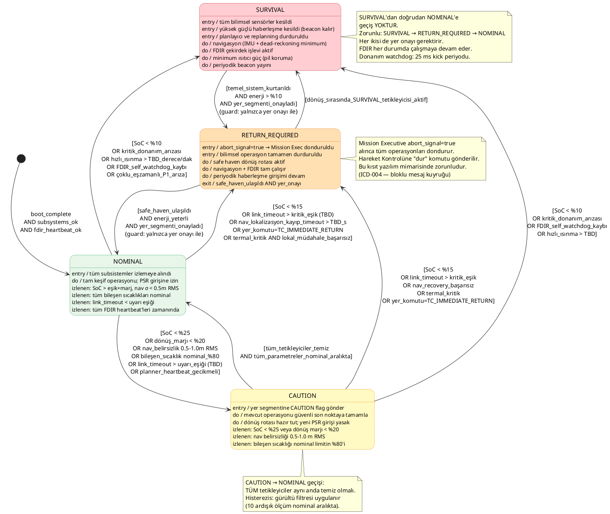

# status: draft
# owner: Agent C
# depends_on: [docs/architecture/ICD_TEMPLATES.md, docs/architecture/SAFETY_STATE_MACHINE.md, docs/adr/FMEA_KRITIK_MODULLER.md, autonomy/autonomy_matrix.md]
# open_items: [ICD referansları ICD_TEMPLATES.md v1.0 ile tutarlı; TBD parametreler diyagramlarda not olarak işaretlendi]

# LUNA-AI PlantUML Diyagramları — v1.0

**Belge ID:** LUNA-AI-ARCH-004  
**Versiyon:** 0.1-draft  
**Tarih:** 2026-11-14  
**Bağlı Belgeler:** LUNA-AI-ARCH-001 (Güvenlik Durum Makinesi), LUNA-AI-ARCH-002 (ICD Şablonları), LUNA-AI-FMEA-001

---

## Diyagram 1 — Bileşen Diyagramı

Tüm modüller, arayüzler ve segment grupları. Yer segmenti / uçuş segmenti / simülasyon paketleri ayrı. Her arayüz üzerinde ICD referansı.

```plantuml
@startuml LUNA-AI Component Diagram

' =====================================================
' LUNA-AI Bileşen Diyagramı v1.0
' Belge: LUNA-AI-ARCH-004
' Bağlı: ICD-001..ICD-006 (LUNA-AI-ARCH-002)
' =====================================================

skinparam componentStyle rectangle
skinparam packageStyle frame
skinparam backgroundColor #FAFAFA
skinparam component {
  BackgroundColor #E8F4FD
  BorderColor #2980B9
}

' =====================================================
' YER SEGMENTİ
' =====================================================
package "Yer Segmenti (Ground Segment)" #EAF7EA {

  package "Bilimsel Analiz & Görev Tasarımı" #D5F0D5 {
    [Mission Intelligence\n(Hedef Puanlama &\nKısıt Kontrolü)] as MI
    [Ground Control UI\n(apps/ground-control)] as GC
    [Data Platform\n(Telemetri İşleme &\nArşiv)] as DP
  }

  package "Görev Planlama Altyapısı" #D5F0D5 {
    [Mission Planner\n(Rota & Kaynak Planlama)] as GMP
    [Orbital Geometry\n(Güneş/Dünya Penceresi)] as OG
  }
}

' =====================================================
' UÇUŞ SEGMENTİ (Araç)
' =====================================================
package "Uçuş Segmenti (Flight Segment — Araç)" #FFF3E0 {

  package "Otonomi & Yürütme" #FFE0B2 {
    [Mission Executive\n(Görev Yürütücü)] as ME
    [Global Planner\n(Rota Planlama)] as GP
    [Local Planner\n(Engel Kaçınma)] as LP
    [Replanner\n(Yeniden Planlama)] as RP
  }

  package "Algı & Navigasyon" #FFE0B2 {
    [Localization\n(EKF + IMU + Landmark)] as LOC
    [Terrain Analyzer\n(LiDAR + Kamera)] as TA
  }

  package "Kaynak Yönetimi" #FFE0B2 {
    [Power Management\n(SoC, Bütçe)] as PM
    [Thermal Management\n(Isıtıcı Kontrolü)] as TM
  }

  package "Güvenlik" #FFE0B2 {
    [FDIR\n(Arıza Tespit & Kurtarma)] as FDIR
    [Safety State Machine\n(NOMINAL/CAUTION/\nRETURN_REQUIRED/SURVIVAL)] as SSM
  }

  package "Donanım Arayüzleri" #FFE0B2 {
    [Motion Control\n(Motor Sürücüleri)] as MC
    [Communication\n(RF Alıcı-Verici)] as COM
    [OBC\n(Ana Bilgisayar)] as OBC
  }
}

' =====================================================
' SİMÜLASYON & DOĞRULAMA SEGMENTİ
' =====================================================
package "Simülasyon & Doğrulama (Simulation Segment)" #F3E5F5 {
  [Digital Twin\n(Araç Simülasyonu)] as DT
  [Environment Model\n(Ay Yüzey Ortamı)] as EM
  [Scenario Runner\n(YAML Senaryo Motoru)] as SR
  [Fault Injector\n(Hata Enjeksiyon)] as FI
  [SIL/HIL Bridge] as HIL
}

' =====================================================
' ARAYÜZLER (ICD referansları ile)
' =====================================================

' ICD-001: Power Mgmt → Mission Planner (uçuşta) / Ground Planner (aşağı yansıma)
PM -right-> ME : ICD-001\nenergy_state\n(1 Hz / 10 Hz CAUTION)
PM -right-> GMP : ICD-001\nenergy_state\n(telemetri yansıması)

' ICD-002: Thermal Mgmt → Mission Executive
TM -right-> ME : ICD-002\nthermal_state\n(1 Hz / 10 Hz CAUTION)

' ICD-003: Navigation → Local Planner
LOC -right-> LP : ICD-003\nvehicle_pose\n(≥10 Hz hareket)
LOC -right-> GP : ICD-003\nvehicle_pose\n(1 Hz nominal)

' ICD-004: FDIR → Mission Executive
FDIR -right-> ME : ICD-004\nsafety_status\n(event-driven + 1 Hz)
SSM --> FDIR : durum geçiş\nkararı

' ICD-005: Ground → Flight (Uplink — CCSDS TC)
GMP -down-> COM : ICD-005\nTC Uplink\n(CCSDS)
GC -down-> COM : ICD-005\nTC_IMMEDIATE\n(P1 Komut)

' ICD-006: Flight → Ground (Downlink — CCSDS TM)
COM -up-> DP : ICD-006\nTM Downlink\n(CCSDS)
COM -up-> GC : ICD-006\nTelemetri\n(1 Hz / 10 Hz)

' Araç iç bağlantılar
ME --> GP : görev adımı\nuygula
GP --> LP : waypoint\nlistesi
LP --> MC : hareket\nkomutu
TA --> LOC : nokta bulutu\n+ görüntü
MC --> LOC : enkoder\ngeri beslemesi
FDIR --> PM : güç kesim\nkomutu (SURVIVAL)
FDIR --> TM : ısıtıcı öncelik\nkomut (CAUTION+)
FDIR --> MC : dur komutu\n(RETURN_REQUIRED)
FDIR --> COM : acil beacon\n(SURVIVAL)
RP --> GP : yeni rota\nplanı

' Simülasyon bağlantıları
DT --> LOC : simüle\ntelemetri
EM --> DT : ortam\nkoşulları
SR --> FI : senaryo\nolayları
FI --> DT : hata enjeksiyonu\n(sensör/motor/güç)
HIL --> OBC : HIL\narayüzü

' Yer iç bağlantılar
MI --> GMP : hedef sıralaması\n+ kısıt listesi
OG --> GMP : pencere\nkısıtları
DP --> MI : işlenmiş\ntelemetri

@enduml
```

---

## Diyagram 2 — PSR Operasyon Sekans Diyagramı

PSR (Permanently Shadowed Region) giriş kararından bilimsel görev bitimine ve safe haven dönüşüne. Kritik mesaj alışverişleri, hata dalları, abort trigger'lar dahil.

---

## Diyagram 3 — Arıza Yönetimi Sekans Diyagramı

Senaryo: Lokalizasyon belirsizliği aşıldı → FDIR kararı → replanning → dönüş veya kurtarma. Bağlı: SC-004 (operational_scenarios.md).

---

## Diyagram 4 — Dağıtım Diyagramı

Araç üzerindeki donanım ve üzerlerinde çalışan yazılım bileşenleri. Yer segmenti sunucuları ve bağlantı tipi.

```plantuml
@startuml LUNA-AI Deployment Diagram

' =====================================================
' Dağıtım Diyagramı v1.0
' Araç donanımı + yer segmenti sunucuları + bağlantı
' =====================================================

skinparam nodeStyle rectangle
skinparam componentStyle rectangle
skinparam backgroundColor #FAFAFA

' =====================================================
' ARAÇ (Flight Hardware)
' =====================================================
node "Araç (Rover)" as ROVER #FFE0B2 {

  node "Ana Bilgisayar (OBC)\n[FreeRTOS, COTS Rad-Hard CPU\nTBD-SNS-001]" as OBC #FFCC80 {
    component [FDIR Task\n(Priority: Highest)] as FDIR_SW
    component [Mission Executive] as ME_SW
    component [Global Planner] as GP_SW
    component [Local Planner] as LP_SW
    component [Replanner] as RP_SW
    component [Power Mgmt Task] as PM_SW
    component [Thermal Mgmt Task] as TM_SW
    component [Communication Task] as COM_SW
  }

  node "Navigasyon İşlemcisi\n[TBD — ayrı SoC veya OBC\nüzerinde ayrı core]" as NAV_CPU #FFCC80 {
    component [EKF Localization] as EKF_SW
    component [Terrain Analyzer] as TA_SW
    component [Sensor Fusion] as SF_SW
  }

  node "IMU Modülü\n[TBD-SNS-001/002]" as IMU_HW #FFD54F {
    component [İvmeölçer + Jiroskop] as IMU_SENS
  }

  node "LiDAR\n[TBD-SNS-001]" as LIDAR_HW #FFD54F {
    component [Nokta Bulutu\nÜretici] as LIDAR_SW
  }

  node "Kamera Sistemi\n[TBD-SNS-001]" as CAM_HW #FFD54F {
    component [Stereo Görüntü\nİşleme] as CAM_SW
  }

  node "RF Modülü\n[TBD-COM-001]" as RF_HW #FFD54F {
    component [Yüksek Kazançlı Anten\n(HGA)] as HGA
    component [UHF Omni Anten\n(Yedek)] as UHF
  }

  node "Güç Sistemi\n[TBD-BAT-001/002, TBD-SOL-001]" as PWR_HW #FFD54F {
    component [Güneş Paneli\n+ Şarj Regülatörü] as SOLAR
    component [Batarya Modülü\n(Dual — TBD-RED-003)] as BAT
    component [PDU\n(Çift Kanal)] as PDU
  }

  node "Termal Sistem\n[TBD-THM-001]" as THM_HW #FFD54F {
    component [Isıtıcılar\n(Birincil + Fallback)] as HEATER
    component [Sıcaklık Sensörleri\n(≥2 bağımsız/nokta)] as TEMP_SENS
  }

  node "Hareket Sistemi" as MOT_HW #FFD54F {
    component [Motor Sürücüleri\n(4+ tekerlekli)] as MOTOR_DRV
    component [Tekerlek Enkoderleri] as ENC
  }

  node "Donanım Watchdog\n[Bağımsız HW Timer]" as HW_WD #EF9A9A {
    component [FDIR HW Watchdog\n(25 ms kick)] as WD_HW
  }
}

' =====================================================
' YER SEGMENTİ
' =====================================================
node "Yer Kontrol Merkezi\n(Ground Segment Sunucu)" as GROUND #E8F5E9 {

  node "Görev Kontrol Sunucusu" as MCS #C8E6C9 {
    component [Ground Control UI\n(apps/ground-control)] as GC_UI
    component [Mission Planner\n(Rota & Kaynak)] as GMP_SW
    component [Mission Intelligence\n(Hedef & Kısıt)] as MI_SW
  }

  node "Veri İşleme Sunucusu" as DPS #C8E6C9 {
    component [Data Platform\n(İngestion + Catalog)] as DP_SW
    component [Telemetri Arşivi] as TM_ARCH
    component [Bilimsel Veri Deposu] as SCI_DATA
  }

  node "Simülasyon Sunucusu" as SIM_SRV #C8E6C9 {
    component [Digital Twin] as DT_SW
    component [Environment Model] as EM_SW
    component [Scenario Runner] as SR_SW
    component [Fault Injector] as FI_SW
  }

  node "Derin Uzay Ağı\n(DSN Anteni)" as DSN #A5D6A7 {
    component [RF Uplink/Downlink\n(CCSDS)] as DSN_RF
  }
}

' =====================================================
' BAĞLANTILAR
' =====================================================

' Araç donanım bağlantıları
OBC --> RF_HW : UART/SPI\nhaberleşme komutu
OBC --> PWR_HW : I2C/CAN\ngüç kontrol
OBC --> THM_HW : GPIO / I2C\nısıtıcı kontrol
OBC --> MOT_HW : CAN Bus\nmotor komutu
OBC --> HW_WD : FDIR HW kick\n(25 ms)
NAV_CPU --> IMU_HW : SPI\nörnekleme (200+ Hz)
NAV_CPU --> LIDAR_HW : Ethernet/PCIe\nnokta bulutu
NAV_CPU --> CAM_HW : USB3/Ethernet\ngörüntü akışı
OBC --> NAV_CPU : IPC / Shared Memory\nvehicle_pose [ICD-003]

' Yer-araç bağlantısı
DSN_RF --> RF_HW : CCSDS TC/TM\n(ICD-005 Uplink / ICD-006 Downlink)\n[TBD-COM-001: frekans, bant]

' Yer iç bağlantılar
GC_UI --> MCS : HTTP/gRPC
GMP_SW --> MI_SW : hedef listesi
DP_SW --> TM_ARCH : telemetri depo
DSN_RF --> DP_SW : ham TM\nalım
SIM_SRV --> DPS : simülasyon\ntelemetrisi
SIM_SRV --> MCS : SIL test\narayüzü

@enduml
```

---

## Diyagram 5 — Güvenlik Durum Makinesi

Nominal / Caution / Return_Required / Survival. Geçiş koşulları ve guard ifadeleri. LUNA-AI-ARCH-001 ile tutarlı.

---

## Diyagram Referans Tablosu

| # | Diyagram | PlantUML Tipi | Kaynak Belgeler | Amaç |
|---|----------|--------------|-----------------|------|
| 1 | Bileşen Diyagramı | Component | ICD-001..006, ADR-005 | Tüm modüller ve arayüzler; segment grupları |
| 2 | PSR Operasyon Sekans | Sequence | SC-003, ICD-001..005, HC-006 | PSR giriş kararı → görev → dönüş; abort dalları |
| 3 | Arıza Yönetimi Sekans | Sequence | SC-004, FMEA-RPN-NAV-001, QAR-NAV-002 | Lokalizasyon kaybı → FDIR → replanning → dönüş |
| 4 | Dağıtım Diyagramı | Deployment | ADR-003, ICD-005/006, TBD-SNS/BAT/COM | Donanım düğümleri, yazılım dağıtımı, bağlantı tipleri |
| 5 | Güvenlik Durum Makinesi | State | LUNA-AI-ARCH-001, ADR-005, QAR FDIR-001..005 | 4 güvenlik durumu, geçiş guard'ları, FDIR bağımsızlığı |

---

## Revizyon Geçmişi

| Versiyon | Tarih | Değişiklik |
|----------|-------|------------|
| 0.1 | 2026-11-14 | İlk taslak — Agent C, C2 görevi; 5 diyagram |
