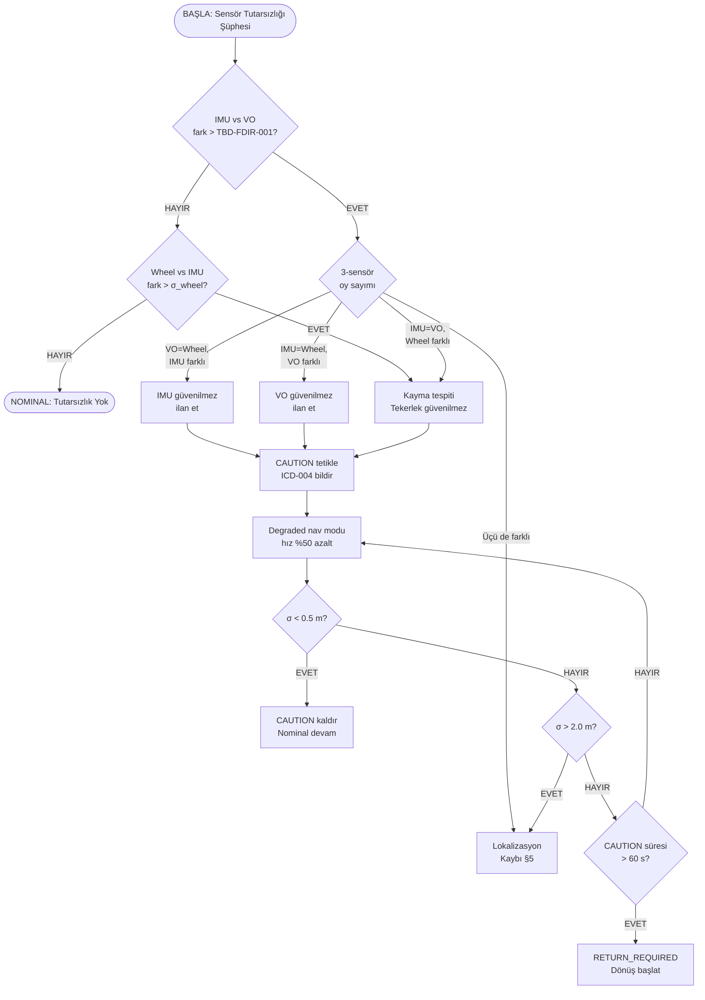
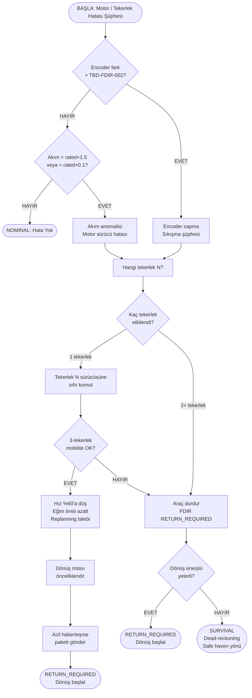
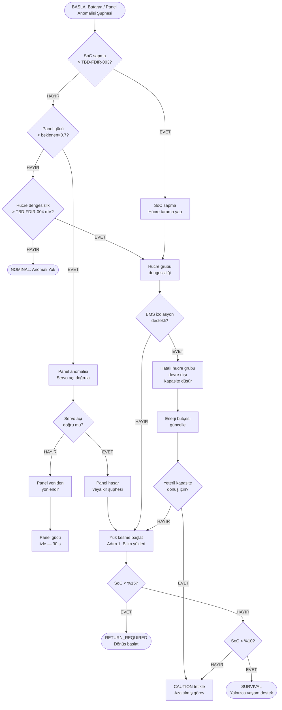
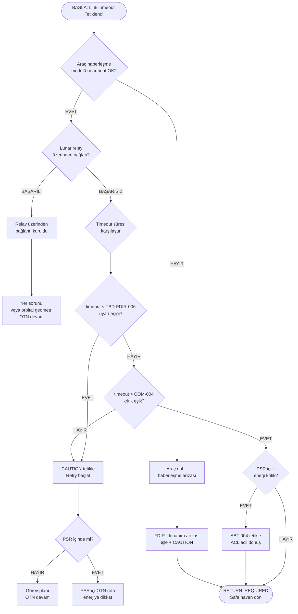
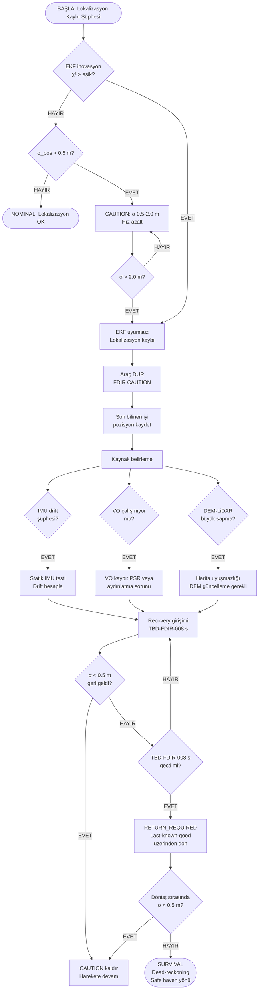

# status: draft
# owner: Agent D
# depends_on:
#   - safety/fdir_implementation.md
#   - docs/architecture/SAFETY_STATE_MACHINE.md
#   - docs/qar/QAR_TABLE.md
# open_items:
#   - TBD-FDIR-001..008 eşikleri kapatıldıkça diyagram sayısal değerler güncellenir

# FDIR Karar Ağaçları — LUNA-AI

**Belge ID:** LUNA-AI-SAF-D2-002
**Versiyon:** 0.1-draft
**Tarih:** 2026-11-14
**Sahip:** Agent D

Mermaid flowchart diyagramları. Her diyagram `flowchart TD` formatındadır.
Tespit → İzolasyon → Recovery adımlarını gösterir.

---

## 1. Sensör Tutarsızlığı

---

## 2. Motor Sıkışması / Tekerlek Hatası

---

## 3. Batarya/Panel Anomalisi

---

## 4. Haberleşme Kesintisi

---

## 5. Lokalizasyon Kaybı

---

*Diyagramlar Mermaid 10.x flowchart TD söz dizimiyle oluşturulmuştur.*
*TBD değerleri `config/tbd_register.md`'de kayıtlıdır; §10 verisi gelince güncellenir.*
